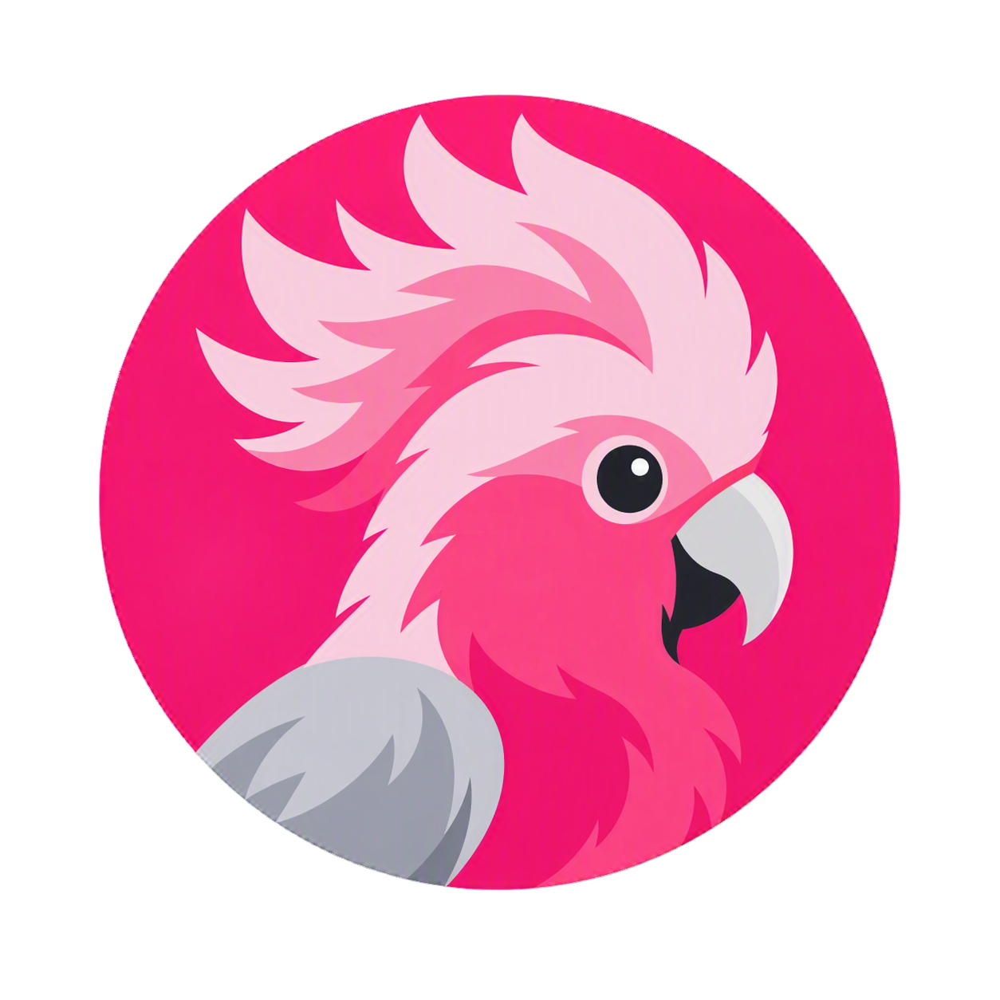
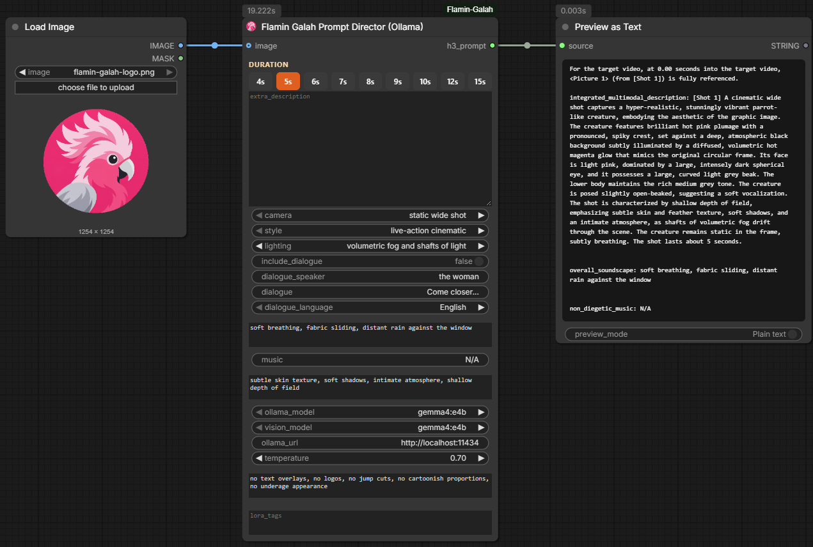
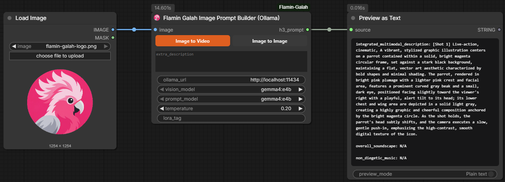
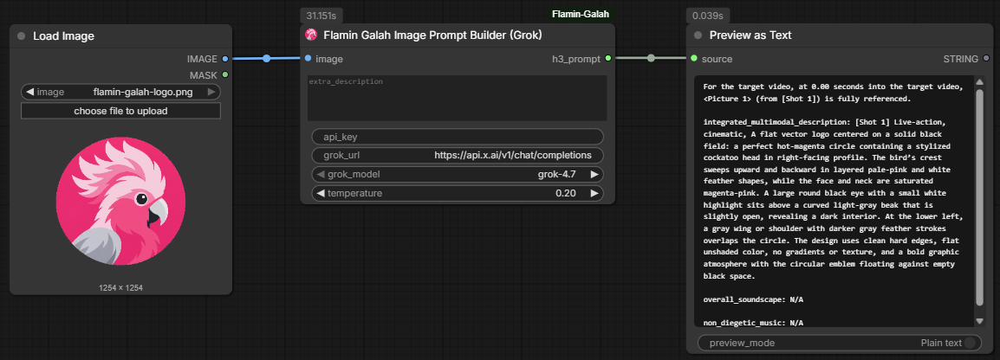
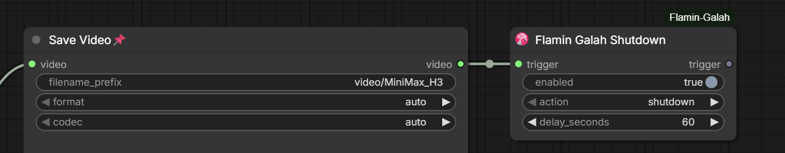

<p align="center">
  
</p>

# ComfyUI Flamin Galah

**Director-style prompt building for MiniMax H3, powered by local Ollama models or the xAI Grok API.**

Turn scene directions or a reference image into structured video prompts, including visual descriptions, soundscapes, and music guidance. All three nodes are geared towards **MiniMax H3**

Every node returns one `STRING` output named **`h3_prompt`**. This pack builds prompts; it does **not** generate images or videos, install MiniMax models, or submit video-generation jobs.

[Repository](https://github.com/flamin-galah/ComfyUI-Flamin-Galah) · [Ollama](https://ollama.com/) · [xAI API documentation](https://docs.x.ai/)

## Nodes at a glance

Prompt nodes appear under **Add Node → prompt → Flamin Galah**. The shutdown node appears under **Add Node → System**.

| Node | Input workflow | Provider | Output |
| --- | --- | --- | --- |
| **Flamin Galah Prompt Director (Ollama)** | Scene fields; optional first-frame image | Ollama | H3-style T2VA or I2VA prompt |
| **Flamin Galah Image Prompt Builder (Ollama)** | Optional `image_1`, optional `image_2`, plus scene directions | Ollama | I2V or I2I from one image, Ref2VA from both, or T2VA with no image |
| **Flamin Galah Image Prompt Builder (Grok)** | Optional `image_1`, optional `image_2`, plus scene directions | xAI Grok API | I2VA from either image, Ref2VA from both, or T2VA with no image |
| **Flamin Galah Shutdown** | Pass-through trigger; enabled toggle; action; delay | Local (Windows) | Pass-through trigger (optional shutdown/reboot) |

**T2VA** means the pack's text-to-video-with-audio prompt mode. **I2VA** means its image-to-video-with-audio prompt mode. These labels describe prompt text, not generation performed by the nodes.

## Installation

### Install the supplied ZIP

1. Extract the ZIP.
2. Place the included `ComfyUI-Flamin-Galah` folder inside `ComfyUI/custom_nodes/`.
3. If updating an existing installation, back it up and replace that folder. **Do not keep two active copies of this pack in `custom_nodes`.**
4. Fully restart ComfyUI, then reload its browser interface.
5. Add the nodes from **prompt → Flamin Galah**.

The resulting layout should be:

```text
ComfyUI/
└── custom_nodes/
    └── ComfyUI-Flamin-Galah/
        ├── __init__.py
        ├── nodes/
        └── web/
```

Avoid an extra nested `ComfyUI-Flamin-Galah/ComfyUI-Flamin-Galah/` folder.

### Clone the upstream repository

```bash
cd ComfyUI/custom_nodes
git clone https://github.com/flamin-galah/ComfyUI-Flamin-Galah.git
```

The upstream repository may still use earlier node titles. Use the supplied ZIP to install this renamed build.

### Requirements

- A working ComfyUI installation.
- `torch`, `numpy`, and `Pillow`, normally included with ComfyUI.
- Ollama with installed models for the two local nodes, or an xAI API key for the Grok node.

There are no additional Python dependencies declared by the pack.

## Ollama setup

The **Prompt Director** and **Image Prompt Builder (Ollama)** call Ollama's `/api/chat` endpoint. The default server is `http://localhost:11434`.

1. Install and start [Ollama](https://ollama.com/download).
2. Pull the recommended models:

   ```bash
   ollama pull gemma4:e4b
   ollama pull goonsai/qwen2.5-3B-goonsai-nsfw-100k
   ```

   - **`gemma4:e4b`** is a general-purpose model that also accepts image input, so it can serve as both the **vision model** and a **writer model**. It needs a recent Ollama (v0.20.0 or newer) and roughly 10 GB of VRAM or 16 GB of unified memory.
   - **`goonsai/qwen2.5-3B-goonsai-nsfw-100k`** is a small (about 6 GB), **text-only** writer model that its publisher describes as built for image and video prompts. Use it for `ollama_model` or `prompt_model`, not for `vision_model`.

3. If you prefer a different vision model, alternatives include `qwen2.5vl`, `llava`, and `llama3.2-vision`. You only need one vision-capable model. A text-writing alternative is `llama3.2`.

4. Start or restart ComfyUI after the models are available.
5. Explicitly select a **vision model** (for example `gemma4:e4b`) for `vision_model` and a **writer model** (for example `gemma4:e4b` or `goonsai/qwen2.5-3B-goonsai-nsfw-100k`) for `ollama_model` or `prompt_model`.

The correct official Qwen vision tag is **`qwen2.5vl`**, not `qwen2.5-vl`. See the [Qwen2.5-VL library page](https://ollama.com/library/qwen2.5vl), the [Gemma 4 library page](https://ollama.com/library/gemma4), and the [goonsai model page](https://ollama.com/goonsai/qwen2.5-3B-goonsai-nsfw-100k).

Model suitability, resource requirements, and response quality depend on the model you select. The `goonsai` model is a community fine-tune intended for adult-oriented prompt writing. For adult-themed creative requests, follow each model's applicable terms and your local laws; support is not guaranteed by this pack.

### Model dropdowns and remote servers

The dropdowns are populated from `GET /api/tags` when ComfyUI requests the node's input schema. Current discovery uses the default localhost server; it does **not** use the custom `ollama_url` widget value.

Installed model names are sorted alphabetically and are not filtered by vision capability. The first selected model may therefore be unsuitable for image input. Restarting ComfyUI is the simplest way to refresh the choices after starting Ollama or pulling a model.

Changing `ollama_url` changes the destination of generation requests. A remote URL sends prompt and image data to that server; the workflow is only local when the configured server is local.

## Grok setup

**Flamin Galah Image Prompt Builder (Grok)** uses this endpoint by default:

```text
https://api.x.ai/v1/chat/completions
```

Provide a key through an environment variable in the process that launches ComfyUI:

```bash
# Linux / macOS shell
export XAI_API_KEY="YOUR_XAI_API_KEY"
```

```powershell
# Windows PowerShell
$env:XAI_API_KEY = "YOUR_XAI_API_KEY"
```

`GROK_API_KEY` is also supported. Alternatively, enter the key in the node's `api_key` widget; a non-empty widget value takes precedence over the environment variables.

**Environment variables are preferable for shareable workflows.** The key widget is a normal visible string field. Check saved workflow files for secrets before sharing them.

The current dropdown contains `grok-4.7`, `grok-4.6`, `grok-4.5`, `grok-4`, and `grok-2-vision-1212`, with `grok-4.7` selected by default. This is a hard-coded list, not live account discovery. Model availability and image support depend on the provider and your account; consult the [current model catalog](https://docs.x.ai/developers/models).

> **Privacy:** the Grok node uploads the first image in the batch and sends prompt text to the configured endpoint. A custom `grok_url` also receives the bearer API key. Use a trusted HTTPS endpoint, and inspect endpoint settings in workflows received from others. Provider usage charges may apply.

## Node reference

### Flamin Galah Prompt Director (Ollama)



Builds a prompt from scene directions and filmmaker-style controls using Ollama.

- **Without an image:** writes a T2VA-style prompt.
- **With an image:** asks a vision model to describe frame 0, then asks a writer model to develop the requested scene as an I2VA-style prompt.
- **Output:** `h3_prompt` (`STRING`).

#### Main widgets

| Widget | Purpose |
| --- | --- |
| `extra_description` | Subject, scene, action, and continuation. Multiline editor; the frontend requests a taller editor for this node. |
| `camera` | Camera angle or motion preset, such as static wide shot, slow push-in, orbit, handheld, or pan. |
| `style` | Visual style preset, including live-action, photorealistic, glamour, anime, cyberpunk, or documentary. |
| `lighting` | Lighting preset, including candlelight, neon, golden hour, moonlight, or chiaroscuro. |
| `duration_seconds` | Desired duration written into the prompt, not a video-generator setting. Backend range: 4–15 seconds. |
| `include_dialogue` | Enables insertion of the supplied dialogue. |
| `dialogue_speaker` | Speaker label. |
| `dialogue` | Exact line to insert; leading and trailing whitespace is trimmed. |
| `dialogue_language` | Language tag. Selecting `other` inserts an unlabelled `<d>…</d>` tag. |
| `soundscape` | Desired diegetic audio, such as ambience, breathing, fabric movement, or footsteps. |
| `music` | Non-diegetic score guidance. Use `N/A` for no score. |
| `extra_details` | Additional texture, atmosphere, depth of field, or scene details. |
| `ollama_model` | Text-writing model. |

The duration pills offer **4, 5, 6, 7, 8, 9, 10, 12, and 15 seconds**. Any duration the model wrote (for example “lasts about 5 seconds”) is replaced with the selected value.

#### Optional inputs

| Input | Purpose |
| --- | --- |
| `image` | Connecting an `IMAGE` enables image-based prompting. Only batch item 0 is used. |
| `vision_model` | Model used to describe the connected image; select a vision-capable model. |
| `ollama_url` | Server URL; defaults to `http://localhost:11434`. |
| `temperature` | Generation temperature; defaults to `0.7`. |
| `negative_notes` | Guidance supplied to the writer, not a separate output field. |
| `lora_tags` | Appends a `LoRA tag:` section after the prompt when populated. |

The writer is instructed to preserve the reference image, describe camera motion, separate visuals from audio, and avoid inventing dialogue. These are model instructions, not a guarantee that every response satisfies every rule.

If the writer fails, this node returns a structured text fallback and logs the failure. If image description fails, the node stops with an error rather than returning a prompt that never saw the image; select a vision-capable model or disconnect the image to write a text-only prompt.

### Flamin Galah Image Prompt Builder (Ollama)



Starts from a still image and uses separate Ollama vision and writing passes. It does not accept video input.

1. The vision model describes the first image in the batch (downsized to a max side of 1024 px and encoded as JPEG).
2. **Grok-style enhance pass** (Image to Video with a non-empty `extra_description`): a dedicated writer call rewrites the description into a stronger `[Shot 1]` paragraph. It locks the source identity, clothing, style, lighting, and composition at 0.00 seconds, then develops every user request only as action and camera that continues after the first frame. It will not turn an illustration or stylized image into live-action. If `extra_description` is empty, a lighter continuation writer is used instead.
3. In **Image to Video** mode, separate calls then write the soundscape and non-diegetic music. **Image to Image** mode skips those calls and returns a plain paragraph.

| Input | Purpose |
| --- | --- |
| `image` | Required `IMAGE`; only batch item 0 is used. |
| `output_mode` | `Image to Video` or `Image to Image`. |
| `extra_description` | Additional action, camera direction, or continuation; empty by default. |
| `vision_model` | Vision-capable Ollama model. |
| `prompt_model` | Ollama writer model. |
| `temperature` | Defaults to `0.2`. |
| `ollama_url` | Defaults to `http://localhost:11434`. |
| `lora_tag` | Optional text appended as a `LoRA tag:` section. |

**Image to Video output:** starts with `For the target video, at 0.00 seconds into the target video, <Picture 1> (from [Shot 1]) is fully referenced.`, followed by one blank line and the three H3 fields. The formatter adds the reference line and a `[Shot 1]` prefix. It does not inject a live-action style. `non_diegetic_music` is written from the shot unless the user asks for no music.

**Image to Image output:** a plain prompt paragraph rather than the three video fields. It still uses the output socket named `h3_prompt`.

The enhance pass (and the lighter fallback) is instructed to establish the image's exact opening style, composition, appearance, pose, lighting, and spatial relationships before developing the requested action. Changes belong after frame 0. `overall_soundscape: N/A` is reserved for explicitly requested complete silence; a quiet or static image alone is not a silence request. Empty video descriptions or soundscapes raise an error rather than silently creating an incomplete prompt.

This node downsizes the image sent to vision to a maximum side of 1024 pixels and encodes it as JPEG. The Prompt Director and Grok node currently use full-resolution PNGs instead.

### Flamin Galah Image Prompt Builder (Grok)



Uses the configured xAI-compatible API rather than Ollama.

1. With either `image_1` or `image_2` connected, describes that still, then rewrites it when `extra_description` is non-empty.
2. With both `image_1` and `image_2` connected, writes an official H3 full-reference prompt. The two stills are subject references, not first and last frames.
3. With no image, writes a T2VA shot from `extra_description`. Text-only mode requires that field.
4. One-image and text-only paths generate a soundscape and a non-diegetic music line. Music is `N/A` only when the user asks for no music.
5. Returns an I2VA block for one image, a six-section Ref2VA block for two images, or a T2VA block when no image is connected.

| Input | Purpose |
| --- | --- |
| `image_1` | Optional `IMAGE`. Alone, an I2VA still. With `image_2`, the Picture 1 subject source. Only batch item 0 is used. |
| `image_2` | Optional `IMAGE`. Alone, an I2VA still. With `image_1`, the Picture 2 subject source. Only batch item 0 is used. |
| `extra_description` | Additional action, camera direction, or continuation; empty by default. |
| `api_key` | Optional widget key; otherwise resolved from the environment. |
| `grok_url` | API endpoint; use only a trusted destination. |
| `grok_model` | Model selected from the bundled list. |
| `temperature` | Defaults to `0.2`. |

A run makes **two model calls**, or **three** when extra directions are supplied. The original image is attached to the first call; later calls use text derived from the description. API failures raise errors rather than using the Prompt Director's structured fallback.

### Flamin Galah Shutdown



Pass-through node for the end of a workflow (for example after a video save). When **enabled** is on, it issues a Windows `shutdown` or `reboot` command after the given delay. When off, it does nothing and simply passes the trigger through.

| Input | Purpose |
| --- | --- |
| `trigger` | Any input. Passed through unchanged. Used so the node can sit after another node (for example Save Video). |
| `enabled` | Boolean toggle. Default `false`. When off, the node does nothing. |
| `action` | `shutdown` or `reboot`. |
| `delay_seconds` | Delay before the action. 10 to 86400, default 60. |

- Windows only. Requires the process to have permission to run `shutdown`.
- Appears under **Add Node → System**.
- To cancel a pending shutdown or reboot, open a Command Prompt and run: `shutdown -a`

## Prompt structure and examples

The video-oriented paths use these fields:

```text
integrated_multimodal_description: [Shot 1] ...

overall_soundscape: ...

non_diegetic_music: ...
```

### Text-based video prompt

```text
integrated_multimodal_description: [Shot 1] Live-action cinematic. A woman in a red coat stands beside a rain-streaked window and slowly turns towards the room. The camera makes a gentle push-in. Warm practical lighting contrasts with the cool blue street outside. The shot lasts about 5 seconds.

overall_soundscape: Rain taps against the glass. Fabric rustles as she turns. Quiet room tone continues underneath.

non_diegetic_music: N/A
```

### Image-based video prompt

The Prompt Director's image path and the Grok node prepend:

```text
For the target video, at 0.00 seconds into the target video, <Picture 1> (from [Shot 1]) is fully referenced.

integrated_multimodal_description: [Shot 1] The scene begins from the supplied still, preserving the subject, clothing, composition, and lighting. The subject slowly turns towards the camera as it moves forward.

overall_soundscape: Soft fabric movement and quiet room ambience.

non_diegetic_music: Sparse piano notes at a slow tempo, joined by a soft sustained pad that fades at the end.
```


Two-image output uses MiniMax H3 full-reference sections, not bracketed production headings. Character stills are cited inside `<Subject 1>` and `<Subject 2>`; standalone `<Picture N>` lines are reserved for concrete frame anchors.

```text
subject_definitions:
<Subject 1> is the primary subject shown in Picture 1, with that still's face, hair, clothing, and distinctive features.
<Subject 2> is the secondary subject shown in Picture 2, with that still's face, hair, clothing, and distinctive features.

summary:
[reference generation] <Subject 1> and <Subject 2> meet in the requested scene while both identities stay intact.

retention_analysis:
<Subject 1> (appears in [Shot 1]): fully_preserved - identity, facial features, clothing, and visual characteristics from Picture 1 are retained.
<Subject 2> (appears in [Shot 1]): fully_preserved - identity, facial features, clothing, and visual characteristics from Picture 2 are retained.

detailed_description:
[Shot 1] ...

overall_soundscape:
...

non_diegetic_music:
...
```

### Ollama Image Prompt Builder video output

The local Image Prompt Builder uses MiniMax's official I2VA opening line in **Image to Video** mode. The `<Picture 1>` marker identifies the actual first frame. The opening visual style and composition must come from that image, not an unconditional live-action preset.

```text
For the target video, at 0.00 seconds into the target video, <Picture 1> (from [Shot 1]) is fully referenced.

integrated_multimodal_description: [Shot 1] 2D vector illustration. The pink cockatoo logo shown in <Picture 1> begins in the same profile, with its pale crest, magenta circular backdrop, black background, palette, and composition preserved. After the opening frame, the crest gently bobs and the bird makes a slight head tilt. The camera pushes in with small amplitude at slow speed while the graphic style remains consistent.

overall_soundscape: Soft feather rustling accompanies the crest movement over a faint airy background.

non_diegetic_music: A light mallet pattern at a moderate tempo, thinning out as the push-in ends.
```

These examples illustrate the pack's intended format. See [MiniMax's official base prompt guide](https://huggingface.co/MiniMaxAI/MiniMax-H3/blob/main/docs/VIDEO_PROMPT_WRITING_GUIDE_base_en.md), especially sections 2.1, 3.1, 4.1, and 4.6, and the [ComfyUI H3 prompt guide](https://docs.comfy.org/tutorials/video/minimax/minimax-h3-prompt-guide). Image to Image mode remains a plain paragraph with no first-frame line. Populated LoRA fields append an extra section, so leave them blank if your downstream consumer expects only the reference line and three fields. Model-generated content still needs review against the actual image; correct structure alone does not guarantee visual fidelity.

## Example workflows

**Text-based video prompting**

```text
Flamin Galah Prompt Director (Ollama) → h3_prompt → your MiniMax H3 prompt consumer
```

**Image-based prompting with the director**

```text
Load Image → Flamin Galah Prompt Director (Ollama) [image input] → h3_prompt
```

**Local image-to-video prompting**

```text
Load Image → Flamin Galah Image Prompt Builder (Ollama) → h3_prompt
```

**Grok image-to-video prompting**

```text
Load Image → Flamin Galah Image Prompt Builder (Grok) → h3_prompt
```

**Two-image reference prompting**

```text
Load Image (primary) → image_1
Load Image (secondary) → image_2
Flamin Galah Image Prompt Builder (Ollama or Grok) → h3_prompt
```

**Shutdown after save**

```text
... → Save Video → Flamin Galah Shutdown (trigger) → (optional)
```
